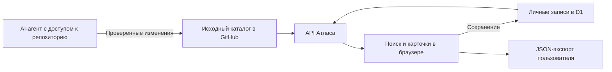

# Атлас инструментов

Личная база знаний о GitHub-проектах, навыках AI-агентов, библиотеках и онлайн-сервисах. Помогает сохранить полезную находку вместе с контекстом: какую задачу она решает, что нужно для запуска, какие есть ограничения и когда к ней стоит вернуться.

**Идея:** превращать поток ссылок в коллекцию, с которой удобно работать человеку и AI-агенту.

[Открыть базу](https://tool-atlas-kb-oct22.chicguppy1.chatgpt.site/) · [Работа с AI-агентом](docs/AI-WORKFLOW.md) · [Устройство среды](docs/RUNTIME.md)

Опубликованный сайт приватный: доступ определяется настройками Sites. Доступ к GitHub-репозиторию выдаётся отдельно.

## Возможности

| Возможность | Зачем нужна |
| --- | --- |
| Визуальные карточки | Быстро просмотреть коллекцию и открыть подробности |
| Поиск по названию, описанию, тегам и заметкам | Найти инструмент по задаче; поддерживается простой транслит, например `uderzhanie` |
| Фильтры по направлению, типу и статусу | Отделить навыки от приложений, библиотек и сервисов |
| Избранное и сортировка | Держать часто используемые инструменты под рукой |
| Статусы | Вести путь «В коллекции» → «Хочу попробовать» → «Использую»; убирать лишнее в «Архив» |
| Подробная карточка | Сохранить назначение, требования, платформу, стоимость, лицензию, ограничения и первые шаги |
| Источники и дата проверки | Вернуться к первоисточнику и понять, когда описание проверяли |
| Личные заметки и редактирование | Записать собственный опыт и дополнить описание |
| Добавление ресурсов | Расширять каталог через интерфейс или исходные данные |
| JSON-экспорт и импорт | Сохранять копию коллекции и добавлять отсутствующие карточки |
| Сценарии работы | Рассматривать несколько инструментов как этапы одной задачи |
| Сохранение в аккаунте | Возвращаться к карточкам, статусам и заметкам при следующем посещении |

Одновременное изменение карточки в двух окнах обнаруживается по номеру ревизии: сервер возвращает конфликт, чтобы не затереть изменения молча. Архив скрыт из обычной выдачи и доступен через фильтр статуса.

## Почему особенно полезно вместе с AI-агентом

Атлас даёт агенту постоянный, структурированный контекст. Агент с доступом к репозиторию может прочитать каталог, изучить новые ссылки, сравнить варианты и подготовить изменения, которые легко проверить через Git diff.

| Польза | Пример |
| --- | --- |
| Меньше повторного поиска | «Что из моей коллекции подходит для монтажа видео в браузере?» |
| Меньше повторных объяснений | Требования и ограничения уже записаны в карточках |
| Более осознанный выбор | Сравнение инструментов под конкретную среду, бюджет и задачу |
| Пополнение в одном формате | Новая ссылка получает описание, теги, источники и дату проверки |
| Связь инструментов с задачами | Последовательность исследования, сценария и сборки ролика |
| Проверяемые изменения | Видно, какие факты добавлены и на каких источниках основаны |
| Накопление собственного опыта | Переданные агенту заметки помогают учитывать прошлые попытки |

В интерфейсе пока нет встроенного AI-чата, семантического поиска или автоматического обновления GitHub-данных. Агент работает с каталогом через репозиторий, предоставленный экспорт либо доступный ему авторизованный интерфейс. Одного доступа к GitHub недостаточно для чтения личных заметок из базы сайта.

Для самого Атласа не нужен ключ LLM-провайдера. Доступ к внешнему агенту, моделям, хостингу и инструментам оплачивается по условиям соответствующих сервисов.

**Пример запроса агенту:**

> Изучи README и docs/AI-WORKFLOW.md. Добавь эти ссылки в каталог: [...]. Проверь официальные источники, опиши назначение, требования, ограничения и стоимость. Не меняй существующие ID и личные заметки. Покажи изменения и результаты проверки.

## Начальная коллекция

В репозитории 14 исходных карточек. Описания проверялись по источникам 22–23 октября 2026 года; наличие карточки не означает, что инструмент установлен или протестирован.

| Направление | Ресурсы |
| --- | --- |
| AI-агенты и навыки | Hermes Agent, Everything Claude Code (ECC) |
| Видео, контент и исследования | MoneyPrinterTurbo, YouTube Agent Skill, Cheat on Content, Social Media Research Skills |
| Карты и миры | Inkarnate, Azgaar's Fantasy Map Generator |
| Облако и серверы | Puter, OpenTrashmail |
| Разработка и локальные инструменты | Portpal, Colibri, ffmpeg.wasm, WebVM |

Ссылки и подробные описания находятся в `app/data.ts` и `app/additional.ts`. Таблица группирует коллекцию для обзора; фильтры интерфейса используют категории самих карточек.

## Как устроены данные



Сервер объединяет исходный каталог с пользовательскими записями в Cloudflare D1, привязанными к ID вошедшего пользователя. Сохранённая пользовательская версия карточки имеет приоритет. Поэтому изменение исходного описания не перезапишет уже отредактированную личную карточку.

**Репозиторий содержит код и начальную коллекцию. Личные заметки и изменения из работающего сайта в Git автоматически не попадают.** Для копии текущей коллекции используй «Экспорт JSON» на сайте. Импорт добавляет отсутствующие карточки и пропускает совпадения по ID или URL; это не восстановление поверх существующих записей. Лимит — 5 МБ и 500 карточек; при ошибке уже добавленные карточки сохраняются.

## Локальный запуск

Нужны Git и Node.js **22.13.0 или новее**. Команды выполняются из корня проекта и подходят для PowerShell и оболочки WSL/Linux.

```sh
git clone https://github.com/GOLHEX/atlas-knowledge-base.git
cd atlas-knowledge-base
npm run install:ci
npm run build
```

После первой сборки создай таблицу в **локальной** базе. Миграцию нужно применить один раз для новой локальной базы:

```sh
node --import ./scripts/sites-env.mjs ./node_modules/wrangler/bin/wrangler.js d1 execute DB --local --config dist/server/wrangler.json --persist-to .wrangler/state --file drizzle/0000_brown_phalanx.sql
npm run dev -- --hostname 127.0.0.1
```

Открой адрес, который напечатает сервер, обычно `http://127.0.0.1:5173`. Для локального тестового входа перейди на `/signin-with-chatgpt?return_to=/`. Эмуляция входа предназначена только для разработки на loopback-адресе. Локальная база независима от опубликованной.

Проверки перед отправкой изменений:

```sh
node node_modules/typescript/bin/tsc --noEmit
node scripts/run-framework.mjs build
git diff --check
```

Если PowerShell блокирует `npm.ps1`, используй `npm.cmd`. Подробности среды, профилей запуска и авторизации — в [docs/RUNTIME.md](docs/RUNTIME.md).

## Структура проекта

| Путь | Содержимое |
| --- | --- |
| `app/atlas.tsx`, `app/globals.css` | Интерфейс и оформление |
| `app/data.ts`, `app/additional.ts` | Тип карточки и исходный каталог |
| `app/api/entries/route.ts` | Чтение, валидация и сохранение карточек |
| `app/chatgpt-auth.ts` | Интеграция с авторизацией Sites |
| `db/`, `drizzle/` | Схема данных и миграции |
| `worker/`, `vite.config.ts`, `scripts/` | Среда выполнения и сборка |
| `.openai/hosting.json` | Привязка к существующему проекту Sites и D1 |
| `ATLAS-MAINTENANCE.md` | Правила обслуживания действующего сайта |
| `export-baseline.mjs` | Экспорт начального каталога в JSON и Markdown |

Стек: React 19, TypeScript, Vinext/Vite, Cloudflare Workers, D1 и Drizzle. `node export-baseline.mjs` записывает начальный каталог в соседнюю с проектом папку `../outputs/`; он не читает личные записи из D1 и не заменяет экспорт через сайт.

## Публикация и границы текущей версии

- GitHub хранит исходники и историю. Push сам по себе не обновляет опубликованный сайт: автоматический деплой из GitHub не настроен.
- Действующий сайт публикуется через Sites. При обновлении нужно сохранять идентификатор проекта, настройки приватности и отдельно применять новые миграции базы.
- Для размещения вне Sites потребуются настройка D1 и адаптация авторизации с доверенной серверной проверкой личности. Это приложение не является статическим сайтом для GitHub Pages.
- Сценарии показывают возможные сочетания инструментов. Автоматические интеграции между ними не реализованы.
- Каталог не устанавливает перечисленные приложения и навыки. Совместимость, лицензии и тарифы следует перепроверять перед применением.

Лицензии сторонних компонентов сохранены в `vendor/` и `scripts/vite/`. Лицензии ресурсов каталога не определяют лицензию самого Атласа; отдельная лицензия на код Атласа пока не выбрана.
